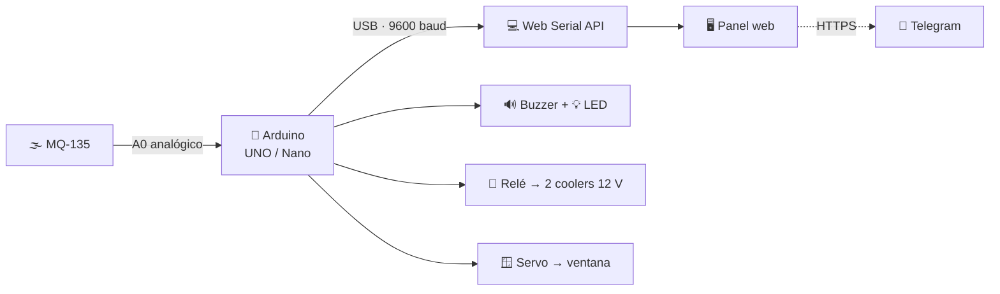

<div align="center">

# 🛡️ GasGuard Pro

### Tu guardián del aire 🌬️

**Monitoreo ambiental y detección temprana de fugas de gas**

*Arduino · MQ-135 · Web Serial API · Telegram*

<p>
  <a href="https://valengarcia09.github.io/Monitor-Fuga-de-Gas/">
    
  </a>
  <a href="https://github.com/valengarcia09/Monitor-Fuga-de-Gas">
    
  </a>
</p>

<p>
  
  
  
  
  
  
</p>

</div>

---

> [!IMPORTANT]
> 🔗 **Demo en vivo:** **[valengarcia09.github.io/Monitor-Fuga-de-Gas](https://valengarcia09.github.io/Monitor-Fuga-de-Gas/)**
>
> Podés probar el panel completo con el simulador, sin conectar ningún hardware.

> [!WARNING]
> **Proyecto educativo.** No reemplaza un detector de gas certificado. Ante una fuga real: salí del lugar, no toques llaves ni interruptores y llamá al **100** (Bomberos), **107** (SAME) o **911** desde afuera.

---

## 📖 ¿Qué es GasGuard Pro?

**GasGuard Pro** es un sistema de seguridad ambiental de bajo costo que detecta la presencia de gases nocivos en espacios cerrados y reacciona automáticamente para reducir el riesgo.

Combina un **Arduino UNO/Nano** con un sensor **MQ-135**, una interfaz web que corre directamente en el navegador mediante la **Web Serial API** y un bot de **Telegram** para avisarte al celular.

No necesita servidores, bases de datos ni instalar programas: conectás la placa por USB, abrís la página y el panel empieza a mostrar los datos en tiempo real. El monitoreo funciona **sin internet**; la única función que usa la red son las alertas de Telegram.

Pensado para entornos educativos y hogareños, con componentes accesibles y una interfaz pensada para que cualquiera pueda entender qué está pasando.

---

## 🚀 Demo

### 👉 [Abrir GasGuard Pro](https://valengarcia09.github.io/Monitor-Fuga-de-Gas/)

La demo incluye un **modo simulación** para probar todo el panel sin Arduino:

| Botón | Qué hace |
| :--- | :--- |
| 😌 **Simular seguro** | Hace descender el nivel y muestra el estado tranquilo. |
| 🚨 **Simular fuga** | Lleva el nivel por encima del umbral y activa la alerta visual, la guía de emergencia y el historial. |
| 📜 **Ver historial y gráfico completo** | Abre el modal con los eventos guardados y el gráfico extendido. |
| 📲 **Probar alerta Telegram** | Envía un mensaje de prueba si configuraste el bot. |
| 🔔 **Aviso sonoro del navegador** | Activa o desactiva un beep opcional (viene apagado). |

> 🧪 El simulador mueve **solo el panel web**. No enciende los coolers, el servo ni el buzzer físico: esos actuadores dependen del firmware del Arduino.

**Compatibilidad:** para conectar la placa necesitás **Google Chrome o Microsoft Edge de escritorio**. El panel y el simulador se pueden ver en cualquier navegador moderno, pero la Web Serial API no está disponible en Firefox, Safari ni en la mayoría de los celulares.

---

## ⚙️ Cómo funciona



1. El Arduino lee la salida analógica del **MQ-135** cada 1 segundo.
2. Envía el valor por USB a **9600 baudios**.
3. El navegador lo recibe con la **Web Serial API** y actualiza el panel, el gráfico y el historial.
4. Si el valor supera el umbral, el firmware activa la **sirena**, el **LED**, los **coolers** y el **servo** que abre la ventana.
5. La web muestra la **guía de emergencia** y envía la **alerta por Telegram**.
6. Cuando el aire vuelve a valores seguros durante **10 segundos**, el hardware apaga todo y cierra la ventana. La web, por precaución, te pide esperar **5 minutos** antes de volver a entrar.

Todo el procesamiento ocurre en el navegador: no hay nube, no hay servidor y no se guardan datos fuera de tu equipo.

---

## ✨ Características

| | Característica | Qué hace |
| :---: | :--- | :--- |
| 🔌 | **Conexión USB nativa** | Comunicación directa entre Arduino y el navegador con Web Serial API. Sin drivers adicionales más allá del puerto serie. |
| 🚦 | **Sistema de 4 estados** | Tranquilo, precaución, peligro y espera post-fuga, con colores, íconos y mensajes distintos. |
| 🌀 | **Purificación automática** | Un módulo relé enciende dos coolers de 12 V y un servo abre una ventana para ventilar el ambiente. |
| 📲 | **Alertas por Telegram** | Aviso inmediato de fuga, recordatorio cada 5 minutos mientras continúa y mensaje cuando el aire se normaliza. |
| 📈 | **Gráfico en tiempo real** | Renderizado con HTML5 `<canvas>`, sin librerías pesadas, con líneas de umbral y precaución. |
| 📜 | **Historial persistente** | Guarda hasta 100 eventos en `localStorage` con fecha, hora, valor y nivel. Podés borrarlo desde el modal. |
| 🧪 | **Simulador integrado** | Permite mostrar una fuga o un ambiente seguro sin conectar hardware. |
| 📡 | **Watchdog de conexión** | Si pasan 4 segundos sin datos, avisa “sin señal” en vez de quedarse congelado. |
| 🔔 | **Beep opcional** | Pitido de alarma generado con Web Audio API, desactivado por defecto. |
| 🆘 | **Guía de emergencia** | Aparece al detectar peligro, con pasos de qué hacer y qué no hacer, y teléfonos útiles de Argentina. |
| 🌙 | **Interfaz responsive** | Modo oscuro, tarjetas, animaciones y diseño adaptable a distintas pantallas. |
| 🏫 | **Offline-first** | El monitoreo no depende de internet. Solo Telegram necesita conexión. |

> 💡 La interfaz carga fuentes e íconos de Google. Sin internet, el navegador usa tipografías de respaldo y los íconos pueden verse distintos, pero **el monitoreo y las alarmas siguen funcionando**. Si querés un offline visual total, autohospedá esas fuentes.

---

## 🧠 Estados y umbrales

El sensor entrega un valor analógico entre **0 y 1023**. No son PPM calibrados: es el valor crudo del convertidor analógico-digital.

| Estado | Valor | En la placa | En la web |
| :--- | :---: | :--- | :--- |
| 😌 **Tranquilo** | **< 300** | LED apagado, coolers apagados, ventana cerrada. | Tarjeta verde: “Todo tranqui”. |
| ⚠️ **Precaución** | **300 – 400** | LED amarillo fijo, sin sirena. | Tarjeta ámbar: “Nivel de gas subiendo”. |
| 🚨 **Peligro** | **> 400** | Sirena “I-O”, LED intermitente, coolers encendidos y ventana abierta. | Tarjeta roja, guía de emergencia y alerta por Telegram. |
| ⏳ **Espera** | **≤ 300 durante 10 s** | Se apagan los coolers y se cierra la ventana. | Recomienda esperar unos minutos antes de volver a entrar. |

**Histéresis:** para cerrar todo no alcanza con que el valor baje del umbral; tiene que mantenerse por debajo de **300 durante 10 segundos**. Así se evita que el sistema prenda y apague los actuadores todo el tiempo.

> [!NOTE]
> El umbral de peligro está duplicado a propósito: `umbralGas = 400` en `GasGuard.ino` y `UMBRAL = 400` en `java.js`. **Si cambiás uno, cambiá el otro** para que el hardware y la web coincidan.

---

## 🛠️ Hardware

| Cant. | Componente | Función |
| :---: | :--- | :--- |
| 1 | **Arduino UNO / Nano** | Lee el sensor y controla los actuadores. |
| 1 | **Sensor MQ-135** | Detecta gases y calidad del aire de forma analógica. |
| 1 | **Buzzer de 3 pines** | Sirena estilo ambulancia (“I-O”) a 600 y 1000 Hz. |
| 1 | **LED amarillo + resistencia de 220 Ω** | Alerta visual: fijo en precaución, intermitente en peligro. |
| 1 | **Módulo relé de 1 canal** | Enciende y apaga los coolers desde la señal del Arduino. |
| 2 | **Coolers de PC de 12 V** | Renuevan el aire de la habitación. |
| 1 | **Fuente de 12 V** | Alimenta los coolers; el relé conmuta esa línea. |
| 1 | **Servo SG90** | Abre y cierra la ventana (0° cerrada, 90° abierta). |
| — | **Cables, protoboard y fuente de 5 V** | Conexionado general. |

### Recomendaciones de armado

- 🔥 **No alimentes los coolers desde el Arduino.** El Arduino solo maneja la señal `IN` del relé; los coolers van a su propia fuente de 12 V.
- 🔌 **Uní las masas.** La fuente de 12 V, el módulo relé y el Arduino tienen que compartir GND.
- ⚙️ **Revisá la lógica del relé.** La mayoría de los módulos se activan con `LOW`. Si los coolers quedan encendidos al revés, cambiá `RELE_ACTIVO_BAJO` a `false` en el firmware.
- 🪟 **Cuidado con el servo.** Si tiembla o el Arduino se reinicia al moverlo, alimentalo con una fuente externa de 5 V y uní el GND.
- 🌫️ **Dejá calentar el MQ-135.** Las primeras lecturas son inestables. Para mediciones más confiables, dejalo precalentando varias horas (idealmente 24–48 h) antes de usarlo en serio.
- 💧 **Mantené el sensor lejos del agua y la condensación.** No es sumergible.

---

## 🔌 Conexiones

```text
[Arduino UNO / Nano]
  ├── 5V  ─────────────── VCC (MQ-135, buzzer y servo)
  ├── GND ─────────────── GND (MQ-135, buzzer, cátodo del LED, relé y servo)
  ├── A0  ─────────────── AO  (salida analógica del MQ-135)
  ├── D8  ─────────────── S   (señal del buzzer)
  ├── D7  ─────────────── 220 Ω ── ánodo del LED amarillo
  ├── D6  ─────────────── IN  (módulo relé → 2 coolers de 12 V)
  └── D9  ─────────────── señal del servo SG90 (ventana)
```

> ⚡ Los coolers **no** se conectan al Arduino: el relé actúa como interruptor de la fuente de 12 V. Verificá la polaridad y la corriente de tu fuente antes de conectar todo.

---

## 🚀 Puesta en marcha

### 1. Descargá el proyecto

```bash
git clone https://github.com/valengarcia09/Monitor-Fuga-de-Gas.git
cd Monitor-Fuga-de-Gas
```

También podés descargar el ZIP desde el botón **Code → Download ZIP** de GitHub.

### 2. Cargá el firmware

1. Abrí `GasGuard/GasGuard.ino` en el **Arduino IDE**.
2. Seleccioná tu placa (Arduino UNO o Nano) y el puerto correspondiente.
3. Verificá que esté disponible la librería `Servo.h` (viene incluida con el IDE).
4. Cargá el sketch.
5. Si querés comprobar la lectura, abrí el **Monitor Serie a 9600 baudios**.

> [!TIP]
> Cerrá el Monitor Serie antes de conectar la página: el puerto USB es exclusivo y no puede usarlo el IDE y el navegador al mismo tiempo.

### 3. Abrí la interfaz web

**Opción A: la demo online**

👉 [https://valengarcia09.github.io/Monitor-Fuga-de-Gas/](https://valengarcia09.github.io/Monitor-Fuga-de-Gas/)

**Opción B: en tu computadora**

Desde la carpeta del proyecto, levantá un servidor local:

```bash
python -m http.server 8000
```

Y abrí [http://localhost:8000](http://localhost:8000).

> [!IMPORTANT]
> No abras `index.html` haciendo doble clic (`file://`) si el puerto no aparece. La Web Serial API necesita un contexto seguro: `https://` o `http://localhost`. La demo de GitHub Pages ya cumple con eso.

### 4. Conectá el Arduino

1. Usá **Chrome o Edge de escritorio**.
2. Hacé clic en **🔌 Conectar Arduino (USB)**.
3. Elegí el puerto que corresponde a tu placa.
4. El panel debería empezar a actualizarse cada segundo.

### 5. Probá sin hardware

Hacé clic en **🚨 Simular fuga** y mirá cómo cambian la tarjeta de estado, el gráfico, el historial y la guía de emergencia. Después probá **😌 Simular seguro** para volver a la normalidad.

---

## 📂 Estructura del proyecto

```text
Monitor-Fuga-de-Gas/
├── GasGuard/
│   └── GasGuard.ino      # Firmware: sensor, sirena, relé y servo
├── index.html            # Panel web
├── estilos.css           # Interfaz oscura y responsive
├── java.js               # Web Serial, estados, gráficos, historial y Telegram
└── README.md
```

---

## 🔧 Configuración

| Archivo | Constante | Valor por defecto | Qué controla |
| :--- | :--- | :---: | :--- |
| `java.js` | `UMBRAL` | `400` | Umbral de peligro en la web. Debe coincidir con el firmware. |
| `GasGuard.ino` | `umbralGas` | `400` | Umbral de peligro en la placa. |
| `GasGuard.ino` | `umbralCierre` | `300` | Valor por debajo del cual se considera “purificado”. |
| `java.js` | `NIVEL_PRECAUCION` | `300` | Inicio de la franja ámbar. |
| `java.js` | `TIMEOUT_MS` | `4000` | Tiempo sin datos antes de mostrar “sin señal”. |
| `java.js` | `ESPERA_MS` | `5 min` | Espera recomendada después de una fuga. |
| `java.js` | `MAX_PUNTOS_GRAFICO` | `30` | Puntos visibles en el gráfico en vivo. |
| `java.js` | `HISTORIAL_MAX_EVENTOS` | `100` | Cantidad máxima de eventos guardados. |
| `GasGuard.ino` | `PURIFICADO_MS` | `10000` | Aire limpio sostenido antes de cerrar todo. |
| `GasGuard.ino` | `RELE_ACTIVO_BAJO` | `true` | Polaridad del módulo relé. |
| `GasGuard.ino` | `ANGULO_ABIERTA` | `90` | Ángulo del servo con la ventana abierta. |

### 📲 Configurar Telegram

1. Hablá con **[@BotFather](https://t.me/BotFather)** y creá un bot con `/newbot`.
2. Guardá el **token** que te entrega.
3. Mandale un mensaje a tu bot (por ejemplo, `/start`) para habilitar el chat.
4. Obtené tu **chat_id** abriendo esta URL en el navegador:

```text
https://api.telegram.org/bot<TU_TOKEN>/getUpdates
```

Buscá el campo `"chat":{"id":...}`.

5. Editá la configuración al inicio de `java.js`:

```js
const ALERTA_TELEGRAM = {
    token: "TU_TOKEN",
    chat_id: "TU_CHAT_ID",
    recordatorioMs: 5 * 60 * 1000 // recordatorio cada 5 minutos
};
```

6. Recargá la página y usá **📲 Probar alerta Telegram**.

> [!CAUTION]
> **El token de un bot no es secreto si está en el frontend.** Cualquiera que abra `java.js` puede verlo y usar tu bot. No lo subas al repositorio; si ya lo hiciste, revocalo con `@BotFather` (`/revoke`) y generá uno nuevo.
>
> Para un proyecto real, lo ideal es mover el envío a un backend o a una función serverless que guarde el token del lado del servidor. Para un trabajo escolar, usá un bot dedicado y no lo compartas.

---

## 📲 Alertas de Telegram

| Momento | Mensaje |
| :--- | :--- |
| 🚨 **Fuga detectada** | Aviso inmediato con la hora y el nivel del sensor. |
| ⏰ **La fuga continúa** | Recordatorio automático cada 5 minutos. |
| 🟢 **Aire normalizado** | Aviso cuando el valor vuelve a zona segura. |
| 🧪 **Prueba manual** | Mensaje de test desde el botón del panel. |

El envío se hace con `fetch` en modo `no-cors`. Eso permite que el navegador mande el mensaje aunque Telegram no autorice leer la respuesta desde la página. Si el mensaje no llega, revisá el token, el `chat_id` y que hayas iniciado el chat con el bot.

---

## 🧪 Cómo probar el proyecto

### Sin hardware

Usá el simulador de la demo. Es la forma más segura de ver todos los estados, el historial y la guía de emergencia.

### Con hardware, sin gas

Para comprobar que la sirena, el relé, los coolers y el servo responden, podés hacer una prueba controlada:

1. Bajá temporalmente `umbralGas` a `50` en `GasGuard.ino`.
2. Cargá el sketch y verificá que se active la secuencia de peligro.
3. Volvé a dejar `umbralGas = 400` y cargá de nuevo.

> [!WARNING]
> No expongas el sensor a gas real, llamas ni encendedores. Para pruebas con sustancias, seguí las indicaciones de tu docente y hacelo en un lugar ventilado.

---

## 🩺 Solución de problemas

| Problema | Causa probable | Solución |
| :--- | :--- | :--- |
| “Tu navegador no soporta Web Serial” | Navegador incompatible o contexto no seguro. | Usá Chrome/Edge de escritorio y abrí la página por `https://` o `localhost`. |
| No aparece el puerto | Cable sin datos, driver faltante o puerto ocupado. | Probá otro cable USB, instalá el driver CH340/CP2102 y cerrá el Monitor Serie del IDE. |
| “SIN SEÑAL DEL SENSOR” | No llegan datos o el baudrate no coincide. | Verificá `Serial.begin(9600)`, el cable y que el Arduino esté enviando líneas. |
| Los valores no cambian | Quedó activo el simulador o se congeló la lectura. | Desconectá y volvé a conectar; recargá la página si es necesario. |
| Los coolers funcionan al revés | El módulo relé usa lógica activa alta. | Cambiá `RELE_ACTIVO_BAJO` a `false`. |
| El servo tiembla o el Arduino se reinicia | Consumo del servo. | Alimentá el servo con una fuente externa de 5 V y uní el GND. |
| Telegram no envía | Token/chat_id incorrectos o chat no iniciado. | Revisá la configuración, mandale `/start` al bot y usá el botón de prueba. |
| El sensor marca siempre 0 o 1023 | Conexión incorrecta o sensor frío/dañado. | Revisá VCC, GND y A0; dejá precalentar el MQ-135. |
| La página se ve sin estilos | Falta `estilos.css` o se abrió desde otra carpeta. | Mantené los archivos juntos y serví la carpeta completa. |
| El historial está vacío | Todavía no hubo cambios de estado o el navegador bloquea `localStorage`. | Probá el simulador y evitá el modo incógnito. |

---

## ⚠️ Seguridad, límites y alcance

Este es un **proyecto educativo y de divulgación**. Está pensado para aprender sobre sensores, electrónica y desarrollo web, no para proteger vidas por sí solo.

- 🧪 **No es un detector certificado.** Un detector comercial cumple normas y está calibrado para gases específicos.
- 🌫️ **El MQ-135 no es selectivo.** Puede reaccionar a humo, alcohol, amoníaco, vapores de limpieza, CO₂ y otros compuestos. Una lectura alta no confirma qué gas hay.
- 📊 **Los valores no son PPM reales.** El panel muestra el valor crudo del ADC (0–1023). Para obtener PPM aproximados hay que calibrar el sensor (Rs/R0) y aplicar la curva correspondiente.
- 🚫 **No detecta monóxido de carbono de forma confiable.** El CO es inodoro y requiere un detector específico certificado.
- 🔥 **Ante una fuga real:** no toques interruptores, enchufes ni llaves que puedan generar chispas; no uses fuego; salí y llamá desde afuera al **100**, **107** o **911**.
- ⚡ **Cuidado con la electricidad.** Si usás 220 V para la fuente o algún actuador, hacelo con un electricista matriculado, gabinete, fusibles y puesta a tierra. El proyecto está pensado para operar los coolers con 12 V.

---

## 🗺️ Ideas para seguir

- [x] Panel web con Web Serial API.
- [x] Sistema tri-estado + espera post-fuga.
- [x] Alertas por Telegram.
- [x] Historial persistente y gráficos.
- [ ] Mover el envío de Telegram a un backend/proxy para ocultar el token.
- [ ] Gabinete impreso en 3D para el Arduino, el relé y el servo.
- [ ] Asistente de calibración para aproximar PPM.
- [ ] Compensación por temperatura y humedad (DHT22 / BME280).
- [ ] Convertirlo en PWA instalable.
- [ ] Versión con ESP32 y Wi-Fi.
- [ ] Tests automatizados y GitHub Actions.
- [ ] Traducción del README al inglés.

---

## 🤝 Contribuir

Las ideas, correcciones y mejoras son bienvenidas.

1. Hacé un fork del repositorio.
2. Creá una rama: `git checkout -b feat/mi-mejora`.
3. Hacé tus cambios y commiteá: `git commit -m "feat: agrega mi mejora"`.
4. Subí la rama: `git push origin feat/mi-mejora`.
5. Abrí un Pull Request.

Si encontrás un bug o querés proponer algo, abrí un **issue** con una descripción clara y, si podés, una captura o los pasos para reproducirlo.

---

## 📄 Licencia

Actualmente el proyecto **no tiene un archivo de licencia formal**. Se comparte con fines educativos y de aprendizaje.

Si querés reutilizarlo, modificarlo o publicarlo, citá el repositorio y contactá a la autora. Si te interesa una licencia abierta, **MIT** es una buena opción para agregar un `LICENSE`.

---

## 👩‍💻 Créditos

Creado y desarrollado por **[@valengarcia09](https://github.com/valengarcia09)** Y **[ziongarcia02jf](https://github.com/ziongarcia02jf)**

Construido con:

- [Arduino](https://www.arduino.cc/)
- [Web Serial API](https://developer.mozilla.org/es/docs/Web/API/Web_Serial_API)
- HTML5 Canvas
- [Telegram Bot API](https://core.telegram.org/bots/api)

Inspirado en la necesidad de espacios escolares más seguros y en la comunidad educativa del programa **Juana Manso**.

---

<div align="center">

**Hecho con 💚, Arduino y muchas ganas de cuidar el aire.**

Si el proyecto te sirvió, dejale una ⭐ al repo. ¡Ayuda un montón!

[⬆ Volver arriba](#)

</div>
