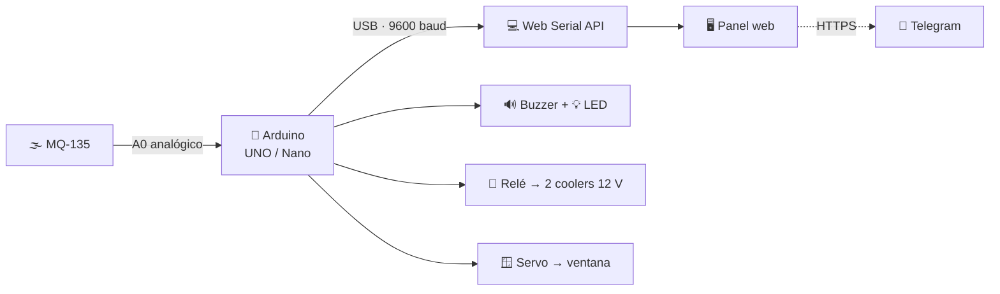

<div align="center">

# 🛡️ GasGuard Pro

### Tu guardián del aire 🌬️

**Monitoreo ambiental y detección temprana de fugas de gas**

*Arduino · MQ-135 · Web Serial API · Telegram*

<p>
  <a href="https://valencarrera09.github.io/Monitor-Fuga-de-Gas/">
    
  </a>
  <a href="https://github.com/valengarcia09/Monitor-Fuga-de-Gas">
    
  </a>
</p>

<p>
  
  
  
  
  
  
</p>

</div>

---

> [!IMPORTANT]
> 🔗 **Demo en vivo:** **[valengarcia09.github.io/Monitor-Fuga-de-Gas](https://valengarcia09.github.io/Monitor-Fuga-de-Gas/)**
>
> Podés probar el panel completo con el simulador, sin conectar ningún hardware.

> [!WARNING]
> **Proyecto educativo.** No reemplaza un detector de gas certificado. Ante una fuga real: salí del lugar, no toques llaves ni interruptores y llamá al **100** (Bomberos), **107** (SAME) o **911** desde afuera.

---

## 📖 ¿Qué es GasGuard Pro?

**GasGuard Pro** es un sistema de seguridad ambiental de bajo costo que detecta la presencia de gases nocivos en espacios cerrados y reacciona automáticamente para reducir el riesgo.

Combina un **Arduino UNO/Nano** con un sensor **MQ-135**, una interfaz web que corre directamente en el navegador mediante la **Web Serial API** y un bot de **Telegram** para avisarte al celular.

No necesita servidores, bases de datos ni instalar programas: conectás la placa por USB, abrís la página y el panel empieza a mostrar los datos en tiempo real. El monitoreo funciona **sin internet**; la única función que usa la red son las alertas de Telegram.

Pensado para entornos educativos y hogareños, con componentes accesibles y una interfaz pensada para que cualquiera pueda entender qué está pasando.

---

## 🚀 Demo

### 👉 [Abrir GasGuard Pro](https://valengarcia09.github.io/Monitor-Fuga-de-Gas/)

La demo incluye un **modo simulación** para probar todo el panel sin Arduino:

| Botón | Qué hace |
| :--- | :--- |
| 😌 **Simular seguro** | Hace descender el nivel y muestra el estado tranquilo. |
| 🚨 **Simular fuga** | Lleva el nivel por encima del umbral y activa la alerta visual, la guía de emergencia y el historial. |
| 📜 **Ver historial y gráfico completo** | Abre el modal con los eventos guardados y el gráfico extendido. |
| 📲 **Probar alerta Telegram** | Envía un mensaje de prueba si configuraste el bot. |
| 🔔 **Aviso sonoro del navegador** | Activa o desactiva un beep opcional (viene apagado). |

> 🧪 El simulador mueve **solo el panel web**. No enciende los coolers, el servo ni el buzzer físico: esos actuadores dependen del firmware del Arduino.

**Compatibilidad:** para conectar la placa necesitás **Google Chrome o Microsoft Edge de escritorio**. El panel y el simulador se pueden ver en cualquier navegador moderno, pero la Web Serial API no está disponible en Firefox, Safari ni en la mayoría de los celulares.

---

## ⚙️ Cómo funciona



1. El Arduino lee la salida analógica del **MQ-135** cada 1 segundo.
2. Envía el valor por USB a **9600 baudios**.
3. El navegador lo recibe con la **Web Serial API** y actualiza el panel, el gráfico y el historial.
4. Si el valor supera el umbral, el firmware activa la **sirena**, el **LED**, los **coolers** y el **servo** que abre la ventana.
5. La web muestra la **guía de emergencia** y envía la **alerta por Telegram**.
6. Cuando el aire vuelve a valores seguros durante **10 segundos**, el hardware apaga todo y cierra la ventana. La web, por precaución, te pide esperar **5 minutos** antes de volver a entrar.

Todo el procesamiento ocurre en el navegador: no hay nube, no hay servidor y no se guardan datos fuera de tu equipo.

---

## ✨ Características

| | Característica | Qué hace |
| :---: | :--- | :--- |
| 🔌 | **Conexión USB nativa** | Comunicación directa entre Arduino y el navegador con Web Serial API. Sin drivers adicionales más allá del puerto serie. |
| 🚦 | **Sistema de 4 estados** | Tranquilo, precaución, peligro y espera post-fuga, con colores, íconos y mensajes distintos. |
| 🌀 | **Purificación automática** | Un módulo relé enciende dos coolers de 12 V y un servo abre una ventana para ventilar el ambiente. |
| 📲 | **Alertas por Telegram** | Aviso inmediato de fuga, recordatorio cada 5 minutos mientras continúa y mensaje cuando el aire se normaliza. |
| 📈 | **Gráfico en tiempo real** | Renderizado con HTML5 `<canvas>`, sin librerías pesadas, con líneas de umbral y precaución. |
| 📜 | **Historial persistente** | Guarda hasta 100 eventos en `localStorage` con fecha, hora, valor y nivel. Podés borrarlo desde el modal. |
| 🧪 | **Simulador integrado** | Permite mostrar una fuga o un ambiente seguro sin conectar hardware. |
| 📡 | **Watchdog de conexión** | Si pasan 4 segundos sin datos, avisa “sin señal” en vez de quedarse congelado. |
| 🔔 | **Beep opcional** | Pitido de alarma generado con Web Audio API, desactivado por defecto. |
| 🆘 | **Guía de emergencia** | Aparece al detectar peligro, con pasos de qué hacer y qué no hacer, y teléfonos útiles de Argentina. |
| 🌙 | **Interfaz responsive** | Modo oscuro, tarjetas, animaciones y diseño adaptable a distintas pantallas. |
| 🏫 | **Offline-first** | El monitoreo no depende de internet. Solo Telegram necesita conexión. |

> 💡 La interfaz carga fuentes e íconos de Google. Sin internet, el navegador usa tipografías de respaldo y los íconos pueden verse distintos, pero **el monitoreo y las alarmas siguen funcionando**. Si querés un offline visual total, autohospedá esas fuentes.

---

## 🧠 Estados y umbrales

El sensor entrega un valor analógico entre **0 y 1023**. No son PPM calibrados: es el valor crudo del convertidor analógico-digital.

| Estado | Valor | En la placa | En la web |
| :--- | :---: | :--- | :--- |
| 😌 **Tranquilo** | **< 300** | LED apagado, coolers apagados, ventana cerrada. | Tarjeta verde: “Todo tranqui”. |
| ⚠️ **Precaución** | **300 – 400** | LED amarillo fijo, sin sirena. | Tarjeta ámbar: “Nivel de gas subiendo”. |
| 🚨 **Peligro** | **> 400** | Sirena “I-O”, LED intermitente, coolers encendidos y ventana abierta. | Tarjeta roja, guía de emergencia y alerta por Telegram. |
| ⏳ **Espera** | **≤ 300 durante 10 s** | Se apagan los coolers y se cierra la ventana. | Recomienda esperar unos minutos antes de volver a entrar. |

**Histéresis:** para cerrar todo no alcanza con que el valor baje del umbral; tiene que mantenerse por debajo de **300 durante 10 segundos**. Así se evita que el sistema prenda y apague los actuadores todo el tiempo.

> [!NOTE]
> El umbral de peligro está duplicado a propósito: `umbralGas = 400` en `GasGuard.ino` y `UMBRAL = 400` en `java.js`. **Si cambiás uno, cambiá el otro** para que el hardware y la web coincidan.

---

## 🛠️ Hardware

| Cant. | Componente | Función |
| :---: | :--- | :--- |
| 1 | **Arduino UNO / Nano** | Lee el sensor y controla los actuadores. |
| 1 | **Sensor MQ-135** | Detecta gases y calidad del aire de forma analógica. |
| 1 | **Buzzer de 3 pines** | Sirena estilo ambulancia (“I-O”) a 600 y 1000 Hz. |
| 1 | **LED amarillo + resistencia de 220 Ω** | Alerta visual: fijo en precaución, intermitente en peligro. |
| 1 | **Módulo relé de 1 canal** | Enciende y apaga los coolers desde la señal del Arduino. |
| 2 | **Coolers de PC de 12 V** | Renuevan el aire de la habitación. |
| 1 | **Fuente de 12 V** | Alimenta los coolers; el relé conmuta esa línea. |
| 1 | **Servo SG90** | Abre y cierra la ventana (0° cerrada, 90° abierta). |
| — | **Cables, protoboard y fuente de 5 V** | Conexionado general. |

## 📂 Estructura del proyecto

```text
Monitor-Fuga-de-Gas/
├── GasGuard/
│   └── GasGuard.ino      # Firmware: sensor, sirena, relé y servo
├── index.html            # Panel web
├── estilos.css           # Interfaz oscura y responsive
├── java.js               # Web Serial, estados, gráficos, historial y Telegram
└── README.md
```

---

## 🗺️ Ideas para seguir

- [x] Panel web con Web Serial API.
- [x] Sistema tri-estado + espera post-fuga.
- [x] Alertas por Telegram.
- [x] Historial persistente y gráficos.
- [ ] Mover el envío de Telegram a un backend/proxy para ocultar el token.
- [ ] Gabinete impreso en 3D para el Arduino, el relé y el servo.
- [ ] Asistente de calibración para aproximar PPM.
- [ ] Compensación por temperatura y humedad (DHT22 / BME280).
- [ ] Convertirlo en PWA instalable.
- [ ] Versión con ESP32 y Wi-Fi.
- [ ] Tests automatizados y GitHub Actions.
- [ ] Traducción del README al inglés.

---

## 👩‍💻 Créditos

Creado y desarrollado por **[@valengarcia09](https://github.com/valengarcia09)** Y **[ziongarcia02jf](https://github.com/ziongarcia02jf)**

Construido con:

- [Arduino](https://www.arduino.cc/)
- [Web Serial API](https://developer.mozilla.org/es/docs/Web/API/Web_Serial_API)
- HTML5 Canvas
- [Telegram Bot API](https://core.telegram.org/bots/api)

Inspirado en la necesidad de espacios escolares más seguros y en la comunidad educativa del programa **Juana Manso**.

---

<div align="center">

**Hecho con 💚, Arduino y muchas ganas de cuidar el aire.**

Si el proyecto te sirvió, dejale una ⭐ al repo. ¡Ayuda un montón!

[⬆ Volver arriba](#)

</div>
